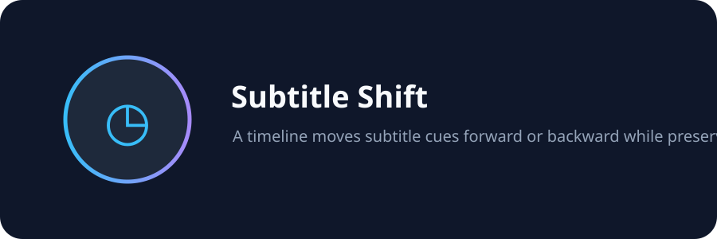

## 🧭 Overview
Subtitle Shift is a dependency-free Python CLI for correcting subtitle timing drift. It validates cue ranges, applies positive or negative millisecond offsets, preserves subtitle text, and writes a separate output file.

## ✨ Features
- ⏱️ Shift every cue by a precise millisecond offset
- 🧪 Check timestamp syntax and cue ordering before editing
- 🧱 Preserve cue numbers and subtitle text
- 🛡️ Refuse to overwrite an existing output file
- 📄 Work with standard SubRip .srt files

## 🎬 Demo
~~~bash
python main.py check movie.srt
python main.py shift movie.srt --offset-ms 1250 --output movie-fixed.srt
~~~
Positive offsets move subtitles later; negative offsets move them earlier.

## 🚀 Quick Start
Requires Python 3.10+. No third-party packages are required.
~~~bash
python main.py check subtitles.srt
python main.py shift subtitles.srt --offset-ms -750 --output subtitles-fixed.srt
python -m unittest discover -s tests
~~~

## 🧰 Tech Stack
- 🐍 Python standard library
- 🕒 Regular expressions and datetime-style arithmetic
- 🧪 unittest

## 🗂️ Folder Structure
~~~text
subtitle-shift/
├── assets/overview.svg
├── tests/test_main.py
├── main.py
├── requirements.txt
├── .gitignore
└── README.md
~~~

## 🗺️ Roadmap
- [ ] 🧩 Support WebVTT files
- [ ] 📊 Add a cue-duration summary
- [ ] 🧪 Add optional batch-folder processing

## 🤝 Contributing
Bug reports and focused pull requests are welcome. Include a reproducible example or a test when changing behavior.

## 📄 License
MIT — see [LICENSE](LICENSE).

